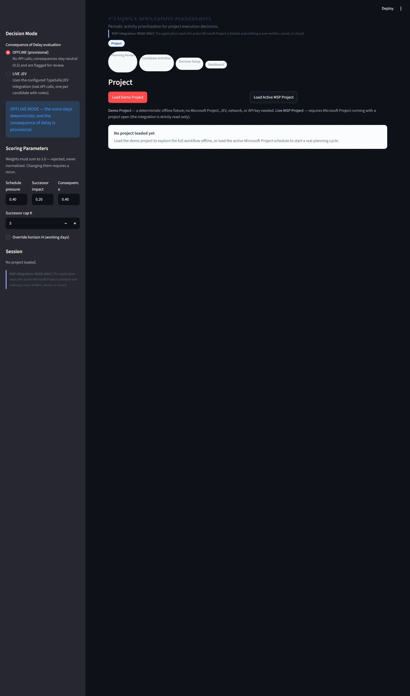
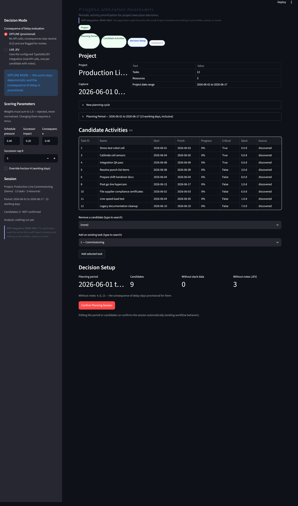
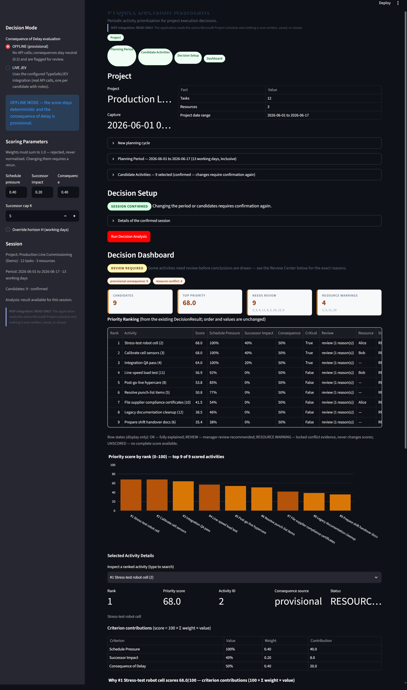
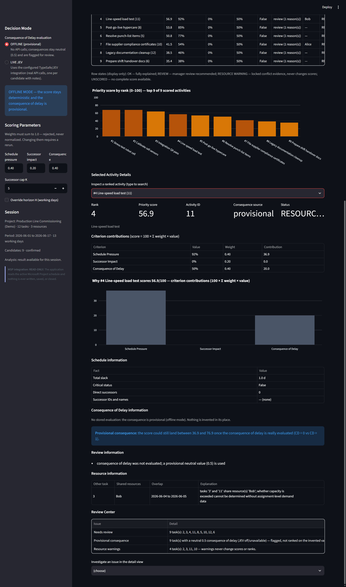
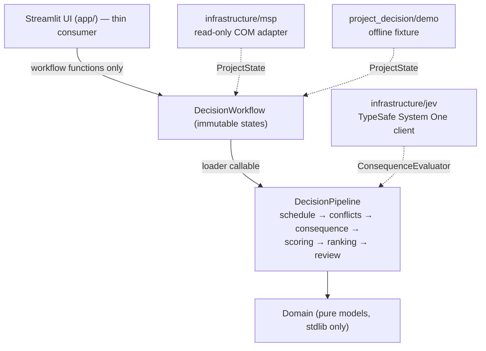

# Project Decision Assistant

A deterministic, read-only **decision-support tool for Microsoft Project
projects**: it turns a captured schedule snapshot into a transparent
priority ranking of the activities a manager must choose between — and
leaves the decision, always, with the human.

> Decision-support, not decision-making. The system never executes a
> ranking as an action, never writes back to Microsoft Project, and
> never optimizes anything. Every number it prints can be traced to a
> documented rule.

## Demo

You can explore the complete application **fully offline** — no
Microsoft Project, no JEV, no API key, no network:

```text
streamlit run app/streamlit_app.py
```

Then click **Load Demo Project**. The demo flows through the *real*
workflow and pipeline with a fixed, deterministic fixture
("Production Line Commissioning"), so repeated runs always produce
identical results. See `docs/demo.md` for a walked-through tour.

Real screenshots of the demo flow (captured from the running app with
`scripts/capture_demo_screenshots.py` — nothing mocked or edited):

| Step | Screenshot |
| --- | --- |
| Project setup (choose source) |  |
| Candidate selection (period + editable funnel) |  |
| Decision dashboard (rank + review + chart) |  |
| Task detail (contributions, consequence provenance, conflicts) |  |

## Try the Application With a Real Microsoft Project File

A substantial, realistic sample project ships in the repository:

```
examples/production-line-commissioning/Production_Line_Commissioning.mpp
```

- **What it is:** a ~120-task, 12-phase industrial commissioning
  project (Production Line Commissioning — Sample Project, 10
  resources, completed/in-progress/future activity mix, real resource
  over-allocation to drive conflict detection).
- **What it is NOT:** it is *not* the built-in Demo Mode. Demo Mode is
  an offline, hard-coded fixture; this sample is a genuine Microsoft
  Project file that must be *opened in Microsoft Project* and is then
  read through the app's existing strict read-only MSP integration.
- **Quick workflow** (Windows + Microsoft Project installed):

  1. Open
     `examples/production-line-commissioning/Production_Line_Commissioning.mpp`
     in Microsoft Project and leave it as the active project window.
  2. Run the app (`streamlit run app/streamlit_app.py`) and click
     **Load Active MSP Project** — the integration reads it
     strictly read-only.
  3. Pick a planning period (a recommended first window is
     `2026-10-22 → 2026-11-06`), confirm the session, and run the
     analysis.

  The same **Sample MSP Project** hint is surfaced in the app's
  Project section (an expander under the Demo / Live buttons) so users
  can discover it without leaving the UI. **No file is opened, saved,
  or closed by this application.**
- **JEV status on this sample:** Consequence of Delay stays offline
  (provisional, flagged for review) unless a `TYPESAFE_API_KEY` is
  configured. There is no fabricated live JEV path — see
  `examples/production-line-commissioning/scenario-data.json` for the
  real JEV input contract and *manual* assessment basis.
- **Detailed guide and verified outcomes:** see
  [the sample's own README](examples/production-line-commissioning/README.md)
  and [expected-results.md](examples/production-line-commissioning/expected-results.md)
  (the numbers there come from the real pipeline and the existing
  `pytest -m msp` suite, all passing against this sample).

## Problem

Managers periodically face a set of **incomplete project activities**
but cannot give equal attention and resources to all of them. Some are
critical, some have successors depending on them, some carry heavy
business consequences if they slip, some share people who are already
double-booked — and all of this lives *inside* the schedule tool, not
in a comparable, explainable picture.

The Project Decision Assistant converts a captured project snapshot
into:

1. **schedule pressure** — how little slack an activity has,
2. **successor impact** — how much of the plan waits behind it,
3. **consequence of delay** — how hard a slip hits the business
   (evaluated qualitatively via the JEV/TypeSafe service, or kept
   explicitly provisional offline),

…combined into one normalized priority index (0–100) with an explicit
review system for every honest gap in the data, and displayed as an
ordered, explainable table a human decides from.

## How It Works

```text
Microsoft Project (read-only)  or  Demo fixture
        ↓
DecisionWorkflow (immutable states)
        ↓
Planning period chosen by the manager
        ↓
Candidate selection (defaults proposed, manager shapes the set)
        ↓
Schedule analysis (slack, successors)  +  Resource conflict analysis
        ↓
Jev consequence evaluation (optional; offline = provisional 0.5)
        ↓
Priority scoring (SP 0.40 + SI 0.20 + CD 0.40 → index 0–100)
        ↓
Deterministic ranking with documented tie-breaks
        ↓
Review center (missing data, provisional consequences, conflicts)
        ↓
Human decision
```

## Architecture

Layered; dependencies point inward. Full description:
`docs/architecture.md`.



- **`app/` (UI)** — widgets, formatting, charts, session state; AST
  tests enforce that it never calls pipeline functions directly and
  contains no business rules.
- **`DecisionWorkflow`** — every user action returns a new immutable
  state; staleness is computed, not guessed, so a result can never be
  displayed against a silently changed session.
- **`DecisionPipeline`** — each stage runs exactly once per analysis,
  deterministically, with no hidden failure handling.
- **Domain** — pure Python models; all snapshot semantics
  (`None` = unavailable) live here.

## Decision Model

Documented exactly, code-verified: `docs/decision-model.md`.

| Criterion | Weight | Formula |
| --- | --- | --- |
| Schedule Pressure (SP) | 0.40 | `1 - min(max(slack, 0), H) / H` |
| Successor Impact (SI) | 0.20 | `min(successors, K) / K` |
| Consequence of Delay (CD) | 0.40 | JEV score / 3, or provisional 0.5 |

```
score = 100 × (0.40·SP + 0.20·SI + 0.40·CD)
```

The result is a **normalized prioritization index, 0–100**. It is NOT:

- a probability or a prediction,
- a calibrated utility,
- an automatic decision or an action.

Weights are validated (must sum to 1.0) and **rejected, never silently
normalized**. When an input is missing (e.g. no slack), the criterion
stays `None` and **no total score is invented**; ranking tie-breaks,
review flags, and "known beats missing" semantics are documented in
`docs/decision-model.md` and covered by tests.

## Review Semantics

The product never hides a gap; it flags it for review:

- **Missing schedule data** — no slack/dates → SP unknown, task stays
  unscored instead of a fabricated zero.
- **Provisional consequence** — JEV unavailable/offline/notes missing →
  CD is a neutral 0.5, provenance shown as `provisional`.
- **Low confidence** — JEV confidence < 0.5 flags review but does NOT
  alter the score (confidence is never a scoring multiplier).
- **JEV failure/unavailability** — structured per-task
  `failed`/`unavailable` states; one task's failure never affects
  another's, and the run continues.
- **Resource warnings** — only *proven* shared-and-overlapping pairs
  (CONFLICT); shares that cannot be decided (UNKNOWN, e.g. a task
  without dates) are reported without a warning.
- Results affected by a changed session, changed parameters, or invalid
  parameter input are cleared with an explanation — never displayed
  stale or next to parameters they were not computed with.

## MSP Integration

- **The product's MSP integration is strictly read-only**: no
  Save/SaveAs/FileSave, no MSP task/resource/schedule mutation — verified
  by tests and validated live against a real Microsoft Project (including
  an end-to-end Streamlit run).
- This is a product-path guarantee, not a claim that the repository
  contains no write operations: the legacy Decision-problems UI writes
  local JSON under `data/decision_problems/`, and
  `scripts/msp_fixture_author.py` is a deliberately write-capable test
  tool that refuses to run without `--i-understand`.
- Requires **Windows**, an **installed Microsoft Project** with a
  project open, and `pywin32` (COM).
- Loads the **active project** through
  `MspComClient → MspProjectAdapter → mapper → ProjectState`.
- Rows Microsoft Project marks as summary/inactive are not mapped; links
  or assignments that point at those rows (or at unmapped resources) are
  omitted from the snapshot and reported as **capture warnings** in the
  Project panel. Nothing is invented to fill the gap.
- Load failures (no active project, COM unavailable) become structured
  WHAT/WHY/NEXT messages — never stack traces, never fabricated data.
- `scripts/msp_field_dump.py` prints a comparison-friendly field report
  of the open project (read-only).

## JEV Integration

JEV (TypeSafe's System One) evaluates the **consequence of delay** of a
candidate activity from its qualitative context:

- the request contains **only task name and notes** — no slack,
  criticality, successors, dates, resources, or scores ever leave the
  process (tested);
- the answer's level score is normalized by the application:
  `CD = score / 3`;
- confidence is preserved and displayed; below 0.5 it flags review
  without touching the score;
- OFFLINE mode (default) is fully usable with no JEV at all.

**Live-service status (honest):** the configured TypeSafe service was
unreachable from the validation environment due to **HTTP 451 regional
availability restriction** (recorded twice, with a real key configured;
the structured error path was observed live). The complete JEV
semantics are verified hermetically with fakes. `pytest -m jev` exists
for an environment where the service is reachable.

To configure: `TYPESAFE_API_KEY=...` in the environment or `.env`
(never committed, never printed, repr-masked; see `.env.example`).

## Demo vs Live

| Capability | Demo | Live MSP |
| --- | --- | --- |
| Project source | in-repo deterministic fixture | active MSP project (read-only) |
| Microsoft Project required | no | **Windows + MSP + pywin32** |
| Network required | no | no |
| JEV / API key | no (provisional CD) | OFFLINE: no · LIVE: yes |
| Deterministic outputs | yes (fixed fixture) | yes (per snapshot) |
| Streamlit AppTest-verifiable | yes | via `msp` markers |

## Installation

```bash
git clone <this repository>
cd project
python -m venv .venv && .venv\Scripts\activate      # Windows
pip install -e .                                      # installs streamlit, plotly, typesafe-sdk
# optional for live MSP:  pip install pywin32
streamlit run app/streamlit_app.py                    # → Load Demo Project
```

Python 3.12+ (developed on 3.14). `pip install -e .[msp]` adds pywin32
for the live MSP loader.

## Testing

```bash
python -m pytest            # hermetic suite: no MSP, no JEV, no network, no key
pytest -m msp               # live MSP integration (auto-skips without an open project)
pytest -m jev               # live JEV call (auto-skips without TYPESAFE_API_KEY)
```

> **Write-capable test tool:** `scripts/msp_fixture_author.py` is the only
> repository script that adds tasks/resources to Microsoft Project. It is
> never used by the product or the tests, does not save/close/quit MSP,
> and exits before any COM access unless run with `--i-understand`.
> Do not run it against a real project.

Verified state of this repository (Windows, Python 3.14):

- **Normal suite: 569 passed, 20 deselected** (all hermetic).
- **msp suite: 19 passed** against a real Microsoft Project session —
  loader chain, field semantics, conflict analysis, dependency
  direction, capture behavior, plus a real end-to-end Streamlit run.
- **jev suite:** not executable here (HTTP 451 region block, documented
  above).

The suite is hermetic by design: `pytest addopts` deselects the
live-integration markers; nothing in the normal run touches MSP, COM,
the network, or a key.

## Repository Structure

```
app/                                product Streamlit UI (thin consumer)
src/project_decision/
    domain/                         pure models (ProjectState = snapshot)
    application/                    workflow, pipeline, analysis, scoring,
    ranking, review; demo/ fixture; config
    infrastructure/msp/             read-only COM integration
    infrastructure/jev/             TypeSafe SDK client
    presentation/                   early dashboard (legacy; MSP read-only,
                                    local JSON decision-problem storage)
tests/                              hermetic suite + fakes + live markers
scripts/                            msp_field_dump.py (read-only report),
    manual_msp_read.py,
    msp_fixture_author.py (WRITE-CAPABLE; requires --i-understand),
    generate_sample_msp.py (WRITE-CAPABLE; requires --i-understand,
    only touches its own fresh sample project)
examples/production-line-commissioning/
    Production_Line_Commissioning.mpp (bundled sample project),
    README.md (user guide), scenario-data.json (JEV scenario),
    expected-results.md (verified outcomes)
docs/                               architecture, decision model, demo guide,
    historical design records
```

## Limitations

- No production deployment story (no Docker, no auth, no database);
  this is a local desktop-style tool.
- MSP integration: Windows-only COM, active project only, read-only for
  Microsoft Project (local JSON authoring and the opt-in fixture tool are
  separate write surfaces, not MSP write-back).
- MSP mapping omits references to skipped summary/inactive rows and to
  unmapped resources; the Project panel reports the omitted counts as
  capture warnings. No relationship is invented to fill the gap.
- Resource conflicts are warning-level; no capacity modeling or
  levelling.
- Live JEV region-blocked in the validation environment; live behavior
  beyond the observed 451 error path is not claimed.
- The prioritization index is decision-support only — accuracy claims
  beyond the documented formulas are explicitly not made.

## Roadmap

Genuinely planned:

- JEV live-mode verification once the service is reachable from a
  supported region (the graded live test is already in place).
- Optional JSON persistence of captured `ProjectState` snapshots for
  later what-if replay.
- Multi-scenario weight presets and saved views (UI-side only).

Not planned: automatic scheduling or decision execution, MSP
write-back, ML/AI scoring, resource optimisation.
