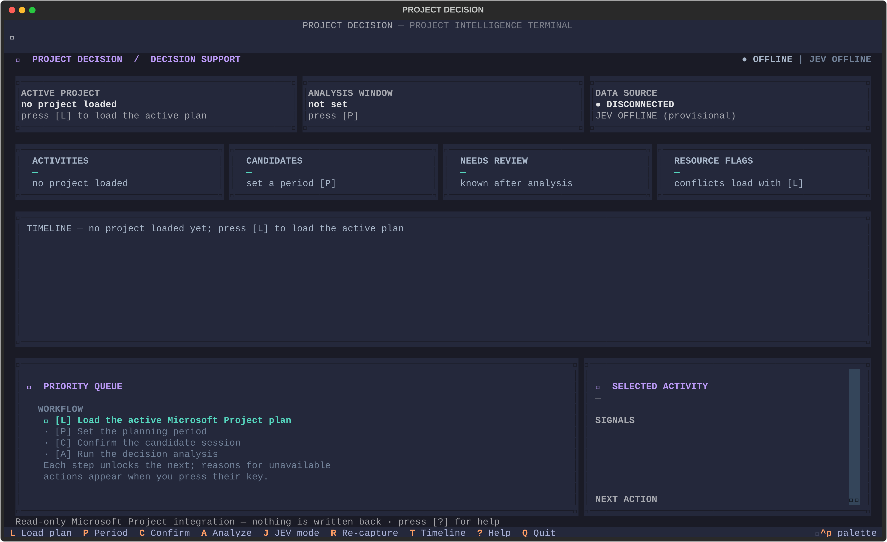
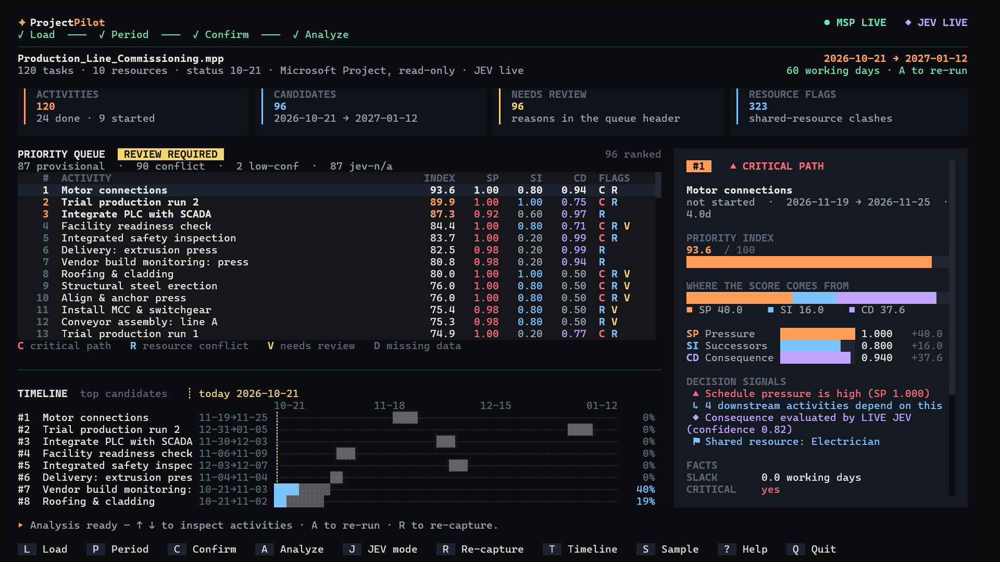
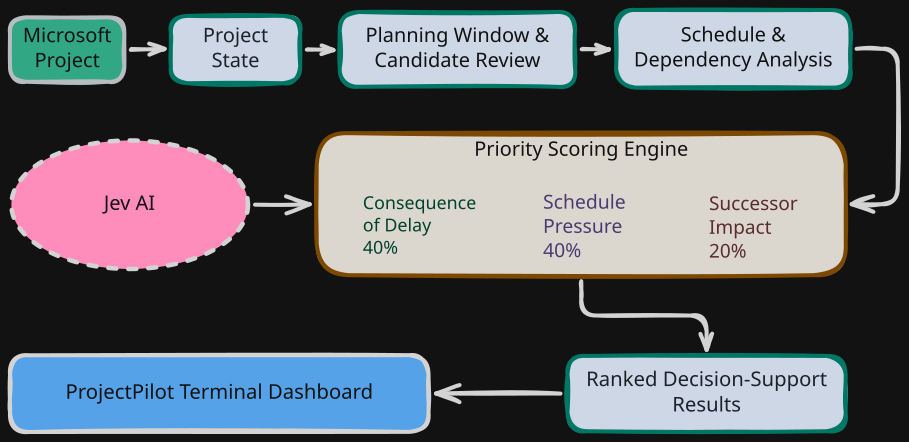

<div align="center" id="readme-top">

  <h1>ProjectPilot</h1>

  <p>
    <strong>Transparent, Human-in-the-Loop Decision Support for Microsoft Project</strong>
    <br>
    <em>Turn complex project schedules into a clear, explainable list of activities that deserve attention first.</em>
  </p>

  <p>
    
    
    <a href="LICENSE"></a>
    <br>
    
    
    
  </p>

  <p>
    <a href="#-dashboard-preview"></a>
    <a href="#-the-problem--solution"></a>
    <a href="#-system-architecture--workflow"></a>
    <a href="#-priority-scoring-engine"></a>
    <a href="#-quick-start"></a>
    <a href="#-industrial-sample-project"></a>
    <a href="#-license"></a>
  </p>

</div>

---

## 🖥️ Dashboard Preview

<div align="center">
  <table>
    <tr>
      <td width="50%">
        
      </td>
      <td width="50%">
        
      </td>
    </tr>
  </table>
  <sub>ProjectPilot's terminal interface for reviewing project priorities and understanding the factors behind each result.</sub>
</div>

---

## 💡 The Problem & Solution

Project managers work with schedules containing hundreds of activities, dependencies, dates, and resource assignments. Finding out which activities deserve attention first requires more than simply viewing a Gantt chart.

**ProjectPilot** addresses one practical question:

> *During the selected planning period, which activities should the project manager review first — and why?*

Microsoft Project provides the scheduling data. ProjectPilot analyzes the available information and produces an explainable priority ranking to help managers focus their attention.

| Operational Dimension | Microsoft Project Schedule | ProjectPilot |
| :--- | :--- | :--- |
| **Attention Scope** | Displays activities across the entire schedule | Helps focus on candidate activities within a selected planning period |
| **Schedule Pressure** | Provides scheduling information such as total slack | Includes schedule pressure as a weighted component of the priority score |
| **Downstream Impact** | Represents activity dependencies | Evaluates the downstream dependency footprint of candidate activities |
| **Consequence of Delay** | Does not automatically provide a complete business-impact assessment | Can use TypeSafe JEV to assess delay consequences when the integration is available |
| **Data Quality** | Reflects the data entered into the schedule | Surfaces relevant data gaps and review flags instead of silently treating missing information as certain |
| **Schedule Safety** | Allows users to edit and update schedules | Reads a schedule snapshot without writing changes back to Microsoft Project |

> [!IMPORTANT]
> **Decision Support, Not Automated Project Management**
>
> ProjectPilot helps the project manager understand priorities. It does not make final management decisions, automatically reschedule activities, or modify the original Microsoft Project plan.

---

## ✨ Key Capabilities

<table>
  <tr>
    <td width="50%" valign="top">
      <h3>🔒 Read-Only Microsoft Project Integration</h3>
      <p>Reads the active Microsoft Project schedule through Windows COM integration. Captured data can include activity names, dates, durations, progress, dependencies, slack, notes, milestones, and resource assignments. Summary rows are excluded from activity-level analysis, and relevant capture problems are surfaced as warnings.</p>
    </td>
    <td width="50%" valign="top">
      <h3>📅 Planning-Period Selection</h3>
      <p>Select a planning window and review the candidate activities proposed for analysis. The workflow allows you to review the candidate set before confirming the session and running the analysis.</p>
    </td>
  </tr>
  <tr>
    <td width="50%" valign="top">
      <h3>⚖️ Explainable Priority Scoring</h3>
      <p>Each scored activity is evaluated using three weighted components: Schedule Pressure (40%), Successor Impact (20%), and Consequence of Delay (40%). The interface presents the score and its component contributions to support human review.</p>
    </td>
    <td width="50%" valign="top">
      <h3>🔗 Dependency and Resource Signals</h3>
      <p>Uses schedule dependencies to assess downstream impact and surfaces relevant resource-overlap signals when the captured assignments and dates support the analysis. These signals help identify activities worth reviewing; they do not perform resource leveling.</p>
    </td>
  </tr>
  <tr>
    <td width="50%" valign="top">
      <h3>🛡️ Explicit Uncertainty and Review Flags</h3>
      <p>When consequence information is unavailable or insufficient, ProjectPilot can use a clearly identified provisional value. Missing required scheduling inputs are not silently invented, and low-confidence JEV assessments are flagged for human review.</p>
    </td>
    <td width="50%" valign="top">
      <h3>⌨️ Keyboard-Driven Terminal Dashboard</h3>
      <p>Built with Python, Textual, and Rich, the terminal interface provides a priority queue, activity inspection, score breakdowns, workflow controls, and status information for the project connection and analysis process.</p>
    </td>
  </tr>
</table>

---

## 🔄 System Architecture & Workflow

<div align="center">
  
</div>

### Main Components

- **Microsoft Project integration:** Captures the active schedule through Windows COM without writing changes back to the project.
- **Project state and schedule analysis:** Maps captured data into the application's project representation and evaluates activity dates, dependencies, and schedule-related signals.
- **Priority scoring engine:** Combines the three scoring components into a weighted priority index.
- **TypeSafe JEV integration:** Supports consequence-of-delay assessment when the external service is configured and available.
- **Terminal user interface:** Presents ranked activities, score explanations, warnings, and review information.

---

## 🧮 Priority Scoring Engine

$$\text{Priority Index} = 100 \times \left( \underbrace{0.40 \times SP}_{\text{Schedule Pressure}} + \underbrace{0.20 \times SI}_{\text{Successor Impact}} + \underbrace{0.40 \times CD}_{\text{Consequence of Delay}} \right)$$

| Component | Weight | Description |
| :--- | :---: | :--- |
| **Schedule&nbsp;Pressure**&nbsp;(`SP`) | 40% | Estimates pressure based on available slack and scheduling data. Activities with little or no slack score higher; missing required data is explicitly flagged. |
| **Successor&nbsp;Impact**&nbsp;(`SI`) | 20% | Evaluates the downstream dependency footprint. Activities that gate or affect multiple subsequent tasks receive higher priority. |
| **Consequence&nbsp;of&nbsp;Delay**&nbsp;(`CD`) | 40% | Assesses potential business impacts (cost, safety, quality, contractual obligations, or production) via TypeSafe JEV (sending only activity name and notes) or an explicit provisional value. |

### Live and Provisional Assessments

When a usable JEV assessment is available, ProjectPilot can use it to calculate the consequence component.

When JEV is unavailable or an assessment cannot be used, the application may use a provisional neutral value of `0.5`, according to the applicable scoring rules. The result must remain visibly provisional and subject to review.

A low-confidence JEV assessment is flagged for review rather than automatically treated as a verified result.

> [!NOTE]
> A provisional score is not equivalent to a verified priority assessment. Interpret it alongside its status, component contributions, and review flags.

### 🔐 Data Handling and Fallback Behavior

| Situation | ProjectPilot Behavior |
| :--- | :--- |
| **Usable JEV assessment available** | Uses the returned assessment for the consequence component according to the scoring rules. |
| **JEV unavailable or not configured** | Uses the applicable provisional behavior, with the result identified as provisional. |
| **JEV confidence below the configured threshold** | Flags the assessment for human review rather than automatically reducing its score. |
| **Required scheduling information missing** | Surfaces the limitation instead of inventing missing schedule values. |
| **Resource or dependency information incomplete** | Reports relevant capture warnings or limitations where detected. |
| **Microsoft Project schedule updated after capture** | Requires a fresh read before analyzing the updated schedule. |

The Microsoft Project integration is read-only. For JEV assessment, only the activity name and notes are sent as inputs; dates, slack values, and resource assignments are not part of that JEV payload.

---

## ⚡ Quick Start

### 1. Prerequisites

- **Operating system:** Windows for live Microsoft Project COM integration.
- **Python:** Python 3.12 or newer as the documented baseline.
- **Microsoft Project:** Installed locally, with the target project open, for live schedule integration.
- **TypeSafe JEV credentials:** Optional, for live consequence assessments.

### 2. Installation (Windows PowerShell)

```powershell
# 1. Clone the repository
git clone https://github.com/mhmdrza-mp4/ProjectPilot.git
cd ProjectPilot

# 2. Create and activate a virtual environment
python -m venv .venv
.\.venv\Scripts\Activate.ps1

# 3. Install ProjectPilot
# On Windows, add the [msp] extra for live Microsoft Project integration:
pip install -e .[msp]

# 4. Launch the terminal dashboard
pda
```

Alternatively, launch the interface with:

```powershell
python -m project_decision.tui
```

If PowerShell blocks virtual-environment activation, temporarily allow it for the current terminal session:

```powershell
Set-ExecutionPolicy -Scope Process Bypass
```

### 3. Connect to Microsoft Project

1. Open the target `.mpp` file in Microsoft Project.
2. Make sure the intended project is active.
3. Launch ProjectPilot.
4. Read the active schedule.
5. Select and review a planning period.
6. Confirm the candidate activities and run the analysis.
7. Inspect the ranked activities, score breakdowns, and review flags.

### 4. Optional: Configure TypeSafe JEV

Configure the credentials required by the installed TypeSafe integration.

If the repository's `.env.example` specifies `TYPESAFE_API_KEY`, create a local `.env` file in the repository root:

```ini
TYPESAFE_API_KEY=your-key-here
```

Keep credentials private and never commit real API keys to version control. Live JEV behavior depends on the service being configured, reachable, and returning a usable assessment.

---

## 🏭 Industrial Sample Project

ProjectPilot includes a sample Microsoft Project schedule representing the **commissioning of a production line**:

```text
examples/
└── production-line-commissioning/
    ├── Production_Line_Commissioning.mpp
    ├── README.md
    ├── scenario-data.json
    └── expected-results.md
```

The sample schedule contains:

- **12 phases**
- **120 leaf activities**
- **10 resources**
- Activity dependencies, scheduling information, and resource assignments for testing the analysis workflow.

### How to Run the Sample

1. Open `Production_Line_Commissioning.mpp` in Microsoft Project.
2. Make sure it is the active project.
3. Launch ProjectPilot and read the active schedule.
4. Select a planning period appropriate to the sample schedule.
5. Review and confirm the proposed candidate activities.
6. Run the decision analysis and inspect the results.

The output depends on the selected planning period, captured schedule data, scoring inputs, and availability of the optional JEV integration.

<p>
  <a href="examples/production-line-commissioning/README.md"></a>
  <a href="examples/production-line-commissioning/expected-results.md"></a>
</p>

---

## 📂 Repository Layout

```text
project/
├── docs/
│   ├── 01 - Product Definition.md
│   ├── 02 - Architecture.md
│   ├── architecture.md
│   ├── decision-model.md
│   └── assets/
│       ├── workflow.svg
│       ├── dashboard-1.png
│       └── dashboard-2.png
├── examples/
│   └── production-line-commissioning/
│       ├── Production_Line_Commissioning.mpp
│       ├── README.md
│       ├── scenario-data.json
│       └── expected-results.md
├── scripts/
│   ├── generate_sample_msp.py
│   ├── manual_msp_read.py
│   ├── msp_field_dump.py
│   └── msp_fixture_author.py
├── src/
│   └── project_decision/
│       ├── application/
│       ├── domain/
│       ├── infrastructure/
│       ├── tui/
│       ├── config.py
│       └── __init__.py
├── tests/
├── .env.example
├── LICENSE
├── pyproject.toml
└── README.md
```

This layout shows the repository's main directories and files. Test, cache, and virtual-environment directories are omitted.

---

## 🧭 Operational Boundaries

- **Human-in-the-loop:** ProjectPilot provides decision support; the project manager remains responsible for the final decision.
- **Read-only integration:** The application reads the active Microsoft Project schedule and does not write schedule changes back to the project.
- **No automatic scheduling:** It does not automatically reschedule activities, optimize the schedule, or perform resource leveling.
- **Conflict detection is not resource planning:** Resource-overlap signals help identify potential issues; they do not establish a complete resource-capacity plan.
- **Snapshot-based analysis:** Changes made in Microsoft Project after capture require a fresh read before the updated schedule is analyzed.
- **Optional JEV integration:** Consequence assessments depend on service configuration, availability, and usable assessment results.
- **Transparent uncertainty:** Provisional results and missing inputs should be reviewed rather than interpreted as certain conclusions.

---

## 📄 License

Distributed under the **MIT License**.

<p>
  <a href="LICENSE"></a>
</p>

---

<div align="center">

  <p>
    <a href="#readme-top"></a>
  </p>

</div>
