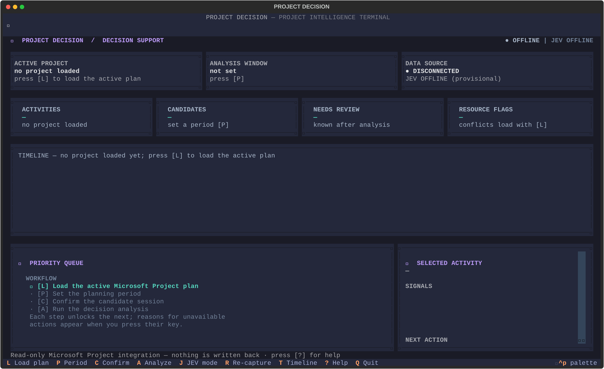
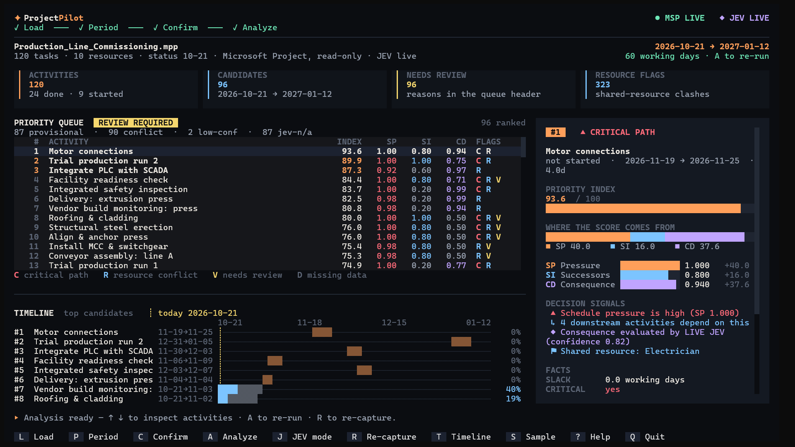
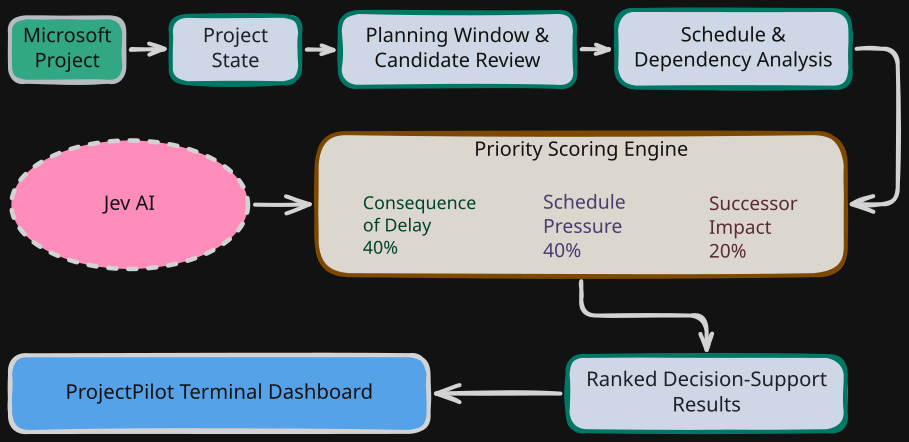

<div align="center" id="readme-top">

  <h1>ProjectPilot</h1>

  <p>
    <strong>Transparent, Human-in-the-Loop Decision Support for Microsoft Project</strong>
    <br>
    <em>Turn complex project schedules into a clear, explainable list of activities that deserve attention first.</em>
  </p>

  <p>
    
    
    <a href="LICENSE"></a>
    <br>
    
    
    
  </p>

  <p>
    <a href="#-dashboard-preview"></a>
    <a href="#-the-problem--solution"></a>
    <a href="#-system-architecture--workflow"></a>
    <a href="#-priority-scoring-engine"></a>
    <a href="#-quick-start"></a>
    <a href="#-one-click-launcher"></a>
    <a href="#-industrial-sample-project"></a>
    <a href="#-license"></a>
  </p>

</div>

---

## 🖥️ Dashboard Preview

<div align="center">
  <table>
    <tr>
      <td width="50%">
        
      </td>
      <td width="50%">
        
      </td>
    </tr>
  </table>
  <sub>ProjectPilot's terminal interface for reviewing project priorities and understanding the factors behind each result.</sub>
</div>

---

## 💡 The Problem & Solution

Project managers work with schedules containing hundreds of activities, dependencies, dates, and resource assignments. Knowing which activities deserve attention first takes more than a Gantt chart.

**ProjectPilot** addresses one practical question:

> *During the selected planning period, which activities should the project manager review first — and why?*

Microsoft Project provides the scheduling data. ProjectPilot analyzes it and produces an explainable priority ranking.

| Operational Dimension | Microsoft Project Schedule | ProjectPilot |
| :--- | :--- | :--- |
| **Attention Scope** | Displays activities across the entire schedule | Focuses on candidate activities within a selected planning period |
| **Schedule Pressure** | Provides scheduling information such as total slack | Includes schedule pressure as a weighted score component |
| **Downstream Impact** | Represents activity dependencies | Evaluates the downstream dependency footprint of candidates |
| **Consequence of Delay** | No complete business-impact assessment | Can use TypeSafe JEV to assess delay consequences when available |
| **Data Quality** | Reflects the data entered into the schedule | Surfaces data gaps and review flags instead of silently treating missing data as certain |
| **Schedule Safety** | Allows users to edit and update schedules | Reads a snapshot and never writes changes back |

> [!IMPORTANT]
> **Decision Support, Not Automated Project Management**
>
> ProjectPilot helps the project manager understand priorities. It does not make final decisions, reschedule activities, or modify the original Microsoft Project plan.

---

## ✨ Key Capabilities

<table>
  <tr>
    <td width="50%" valign="top">
      <h3>Read-Only Microsoft Project Integration</h3>
      <p>Reads the active schedule through Windows COM: names, dates, durations, progress, dependencies, slack, notes, milestones, and resource assignments. Summary rows are excluded from activity-level analysis, and capture problems surface as warnings.</p>
    </td>
    <td width="50%" valign="top">
      <h3>Planning-Period Selection</h3>
      <p>Select a planning window and review the proposed candidate activities before confirming the session and running the analysis.</p>
    </td>
  </tr>
  <tr>
    <td width="50%" valign="top">
      <h3>Explainable Priority Scoring</h3>
      <p>Each activity is scored on three weighted components: Schedule Pressure (40%), Successor Impact (20%), and Consequence of Delay (40%). The interface shows the score and each component's contribution.</p>
    </td>
    <td width="50%" valign="top">
      <h3>Dependency and Resource Signals</h3>
      <p>Uses dependencies to assess downstream impact and surfaces resource-overlap signals when assignments and dates support it. These signals flag activities worth reviewing; they do not perform resource leveling.</p>
    </td>
  </tr>
  <tr>
    <td width="50%" valign="top">
      <h3>Explicit Uncertainty and Review Flags</h3>
      <p>When consequence information is missing, ProjectPilot uses a clearly identified provisional value. Missing scheduling inputs are never invented, and low-confidence JEV assessments are flagged for human review.</p>
    </td>
    <td width="50%" valign="top">
      <h3>Keyboard-Driven Terminal Dashboard</h3>
      <p>Built with Python, Textual, and Rich: priority queue, activity inspection, score breakdowns, workflow controls, and connection/analysis status.</p>
    </td>
  </tr>
</table>

---

## 🔄 System Architecture & Workflow

<div align="center">
  
</div>

### Main Components

- **Launcher (`run.bat` + `run.ps1`):** Prepares the environment (Python, `.venv`, packages), self-tests the dashboard, then starts it. See [One-Click Launcher](#-one-click-launcher).
- **Microsoft Project integration:** Captures the active schedule through Windows COM without writing back.
- **Project state and schedule analysis:** Maps captured data into the application's project representation and evaluates dates, dependencies, and schedule signals.
- **Priority scoring engine:** Combines the three components into a weighted priority index.
- **TypeSafe JEV integration:** Supports consequence-of-delay assessment when the external service is configured and available.
- **Terminal user interface:** Presents ranked activities, score explanations, warnings, and review information.

---

## 🧮 Priority Scoring Engine

$$\text{Priority Index} = 100 \times \left( \underbrace{0.40 \times SP}_{\text{Schedule Pressure}} + \underbrace{0.20 \times SI}_{\text{Successor Impact}} + \underbrace{0.40 \times CD}_{\text{Consequence of Delay}} \right)$$

| Component | Weight | Description |
| :--- | :---: | :--- |
| **Schedule&nbsp;Pressure**&nbsp;(`SP`) | 40% | Pressure based on available slack and scheduling data. Little or no slack scores higher; missing required data is flagged. |
| **Successor&nbsp;Impact**&nbsp;(`SI`) | 20% | Downstream dependency footprint. Activities that gate multiple subsequent tasks rank higher. |
| **Consequence&nbsp;of&nbsp;Delay**&nbsp;(`CD`) | 40% | Potential business impact (cost, safety, quality, contractual obligations, production) via TypeSafe JEV (only activity name and notes are sent) or an explicit provisional value. |

### Live and Provisional Assessments

- A usable JEV assessment feeds the consequence component.
- When JEV is unavailable or unusable, a provisional neutral value of `0.5` may be used under the applicable scoring rules. The result stays visibly provisional and subject to review.
- A low-confidence JEV assessment is flagged for review, not treated as verified.

> [!NOTE]
> A provisional score is not a verified priority assessment. Read it alongside its status, component contributions, and review flags.

### 🔐 Data Handling and Fallback Behavior

| Situation | ProjectPilot Behavior |
| :--- | :--- |
| **Usable JEV assessment available** | Uses it for the consequence component. |
| **JEV unavailable or not configured** | Uses provisional behavior, marked as provisional. |
| **JEV confidence below threshold** | Flags the assessment for human review without reducing its score. |
| **Required scheduling information missing** | Surfaces the limitation instead of inventing values. |
| **Resource or dependency information incomplete** | Reports capture warnings or limitations where detected. |
| **Schedule updated after capture** | Requires a fresh read before analysis. |

The Microsoft Project integration is read-only. For JEV, only the activity name and notes are sent; dates, slack, and resource assignments are not part of the payload.

---

## ⚡ Quick Start

### 1. Prerequisites

- **Operating system:** Windows (required for live Microsoft Project COM integration).
- **Python:** 3.12 or newer. The launcher installs it automatically if missing.
- **Microsoft Project:** Installed locally, with the target project open.
- **TypeSafe JEV credentials:** Optional, for live consequence assessments.

### 2. One-Click Launch (Recommended)

```powershell
git clone https://github.com/mhmdrza-mp4/ProjectPilot.git
cd ProjectPilot
.\run.bat
```

You can also double-click `run.bat` in File Explorer.

> [!TIP]
> `run.bat` starts `run.ps1`, which checks and repairs the environment, then opens the dashboard. See [One-Click Launcher](#-one-click-launcher).

### 3. Manual Installation (Windows PowerShell)

Use these steps instead of the launcher if you prefer to set things up yourself.

```powershell
# 1. Clone the repository
git clone https://github.com/mhmdrza-mp4/ProjectPilot.git
cd ProjectPilot

# 2. Create and activate a virtual environment
python -m venv .venv
.\.venv\Scripts\Activate.ps1

# 3. Install ProjectPilot (the [msp] extra enables live Microsoft Project integration)
pip install -e .[msp]

# 4. Launch the terminal dashboard
pda
```

Alternatively, launch with `python -m project_decision.tui`.

If PowerShell blocks virtual-environment activation, allow it for the current session only:

```powershell
Set-ExecutionPolicy -Scope Process Bypass
```

### 4. Connect to Microsoft Project

1. Open the target `.mpp` file in Microsoft Project and make sure it is the active project.
2. Launch ProjectPilot and read the active schedule.
3. Select and review a planning period.
4. Confirm the candidate activities and run the analysis.
5. Inspect the ranked activities, score breakdowns, and review flags.

> [!TIP]
> `run.ps1` reports whether Microsoft Project is installed, running, and has a plan open, and warns about an admin/non-admin mismatch that breaks COM.

### 5. Optional: Configure TypeSafe JEV

If the repository's `.env.example` specifies `TYPESAFE_API_KEY`, create a local `.env` file in the repository root:

```ini
TYPESAFE_API_KEY=your-key-here
```

Keep credentials private and never commit real keys. Live JEV behavior depends on the service being configured, reachable, and returning a usable assessment.

> [!TIP]
> `run.ps1` reports whether a key is configured (never printing it) or whether provisional mode is used.

---

## 🚀 One-Click Launcher

`run.bat` is the recommended way to start ProjectPilot on Windows. It verifies everything the dashboard needs, repairs what is missing or broken, and opens the dashboard after one key press.

```powershell
.\run.bat
```

Keep `run.bat` and `run.ps1` together in the repository root, next to `pyproject.toml`.

| File | Role |
| :--- | :--- |
| **`run.bat`** | Entry point. Starts `run.ps1` (no system policy change), forwards options and exit codes, and keeps the window open with the log folder on unexpected errors. |
| **`run.ps1`** | Does the work: checks, repairs, dashboard self-test, status notices, logging, and starting the dashboard. |

### What the Launcher Checks and Repairs

| Check | What it does |
| :--- | :--- |
| **System** | Confirms 64-bit Windows, `pyproject.toml`, write access, and free disk space (warns below 1 GB). Warns about small terminals and risky folder paths (non-English characters, cloud-synced folders). |
| **Network** | Tests `pypi.org` and `files.pythonhosted.org` (proxy-aware). Being offline is acceptable when nothing needs installing. |
| **Python 3.12+** | Finds a 64-bit interpreter. If none exists, installs Python 3.12 for the current user (winget first, then the signature-verified python.org installer). |
| **Virtual environment** | Verifies `.venv` and its pip. Restores pip when possible; rebuilds `.venv` when broken. |
| **Packages** | Installs or syncs `.[msp]` only when `pyproject.toml` dependencies changed. If installation fails, rebuilds `.venv` and reinstalls without the pip cache. |
| **Dashboard engine** | Pre-loads the dashboard and runs a headless self-test. On failure, repairs the environment and retries. |
| **Microsoft Project** | Detects COM registration, whether Project is running, and its privilege level. Notice only. |
| **TypeSafe JEV** | Looks for `TYPESAFE_API_KEY` in the environment or `.env` and never prints it. Without a key, reports provisional mode. Notice only. |

> [!NOTE]
> Python is installed without a confirmation prompt unless you pass `-AskBeforeInstall`. The launcher never deletes `.venv` when it cannot re-create it (offline without a wheelhouse).

### Opening the Dashboard

When all checks finish, the launcher shows a summary card and **Press any key to open the dashboard** (`Esc` exits). Nothing loads after the key press, since the dashboard is already verified. If a step fails, the launcher shows the last log lines with a suggested fix.

### Launcher Options

Pass options after the script name, for example `.\run.bat -Repair`.

| Option&nbsp;&nbsp;&nbsp;&nbsp;&nbsp;&nbsp;&nbsp;&nbsp;&nbsp;&nbsp;&nbsp;&nbsp;&nbsp;&nbsp;&nbsp;&nbsp;&nbsp;&nbsp; | Effect |
| :--- | :--- |
| `-Repair` | Clean rebuild of `.venv` and fresh package installation. |
| `-NoPause` | Launches immediately, without the key prompt. |
| `-NoAnim` | Disables animations. |
| `-AskBeforeInstall` | Asks before installing Python automatically. |
| `-Check` | Read-only report of what a normal run would fix. |
| `-Diagnose` | Collects logs and environment facts into one ZIP to share (no keys or `.env`). |
| `-Freeze` | Writes `constraints.txt` with pinned package versions after a passing self-test. |
| `-Offline` | Never uses the network; installs from `.\wheelhouse`. |
| `-Wheelhouse` | Builds `.\wheelhouse` for PCs without internet. |
| `-Update` | Runs `git pull --ff-only` first. |
| `-Uninstall` | Removes `.venv`, logs, and temp files (`-Yes` skips the question). |
| `-Silent` | No UI and no dashboard; plain output and an exit code for CI. |

Exit codes: `0` ok, `2` already running, `3` `-Check` found work to do, `10` handled failure, `99` crash. Logs are stored in `%LOCALAPPDATA%\ProjectPilot\logs`.

> [!TIP]
> Windows Terminal gives the best visuals. Consoles without true-color support fall back to 256 colors, and setting `NO_COLOR` switches to plain ASCII output.

---

## 🏭 Industrial Sample Project

ProjectPilot includes a sample Microsoft Project schedule for the **commissioning of a production line**:

```text
examples/
└── production-line-commissioning/
    ├── Production_Line_Commissioning.mpp
    ├── README.md
    ├── scenario-data.json
    └── expected-results.md
```

The schedule contains **12 phases**, **120 leaf activities**, **10 resources**, plus dependencies, scheduling information, and resource assignments for testing the analysis workflow.

### How to Run the Sample

1. Open `Production_Line_Commissioning.mpp` in Microsoft Project and make it the active project.
2. Launch ProjectPilot and read the active schedule.
3. Select a planning period suited to the sample schedule.
4. Review and confirm the proposed candidate activities.
5. Run the decision analysis and inspect the results.

The output depends on the selected planning period, the captured data, the scoring inputs, and the optional JEV integration.

> [!TIP]
> `run.ps1` warns if the sample `.mpp` file is missing.

<p>
  <a href="examples/production-line-commissioning/README.md"></a>
  <a href="examples/production-line-commissioning/expected-results.md"></a>
</p>

---

## 📂 Repository Layout

```text
project/
├── docs/
│   ├── 01 - Product Definition.md
│   ├── 02 - Architecture.md
│   ├── architecture.md
│   ├── decision-model.md
│   └── assets/
│       ├── workflow.svg
│       ├── dashboard-1.png
│       └── dashboard-2.png
├── examples/
│   └── production-line-commissioning/
│       ├── Production_Line_Commissioning.mpp
│       ├── README.md
│       ├── scenario-data.json
│       └── expected-results.md
├── scripts/
│   ├── generate_sample_msp.py
│   ├── manual_msp_read.py
│   ├── msp_field_dump.py
│   └── msp_fixture_author.py
├── src/
│   └── project_decision/
│       ├── application/
│       ├── domain/
│       ├── infrastructure/
│       ├── tui/
│       ├── config.py
│       └── __init__.py
├── tests/
├── .env.example
├── LICENSE
├── pyproject.toml
├── README.md
├── run.bat          # entry point: starts run.ps1, forwards options and exit codes
└── run.ps1          # launcher: checks, repairs, self-tests, opens the dashboard
```

This layout shows the main directories and files. Test, cache, and virtual-environment directories are omitted.

---

## 🧭 Operational Boundaries

- **Human-in-the-loop:** ProjectPilot provides decision support; the project manager makes the final decision.
- **Read-only integration:** It reads the active Microsoft Project schedule and never writes changes back.
- **No automatic scheduling:** It does not reschedule, optimize, or level resources.
- **Conflict detection is not resource planning:** Resource-overlap signals flag potential issues; they are not a capacity plan.
- **Snapshot-based analysis:** Changes made in Microsoft Project after capture require a fresh read.
- **Optional JEV integration:** Consequence assessments depend on service configuration, availability, and usable results.
- **Launcher scope:** The launcher manages only the project's own `.venv` (it can delete and recreate it) and may install Python 3.12 for the current user. It never modifies Microsoft Project files or prints API keys.
- **Transparent uncertainty:** Review provisional results and missing inputs; do not read them as certain conclusions.

---

## 📄 License

Distributed under the **MIT License**.

<p>
  <a href="LICENSE"></a>
</p>

---

<div align="center">

  <p>
    <a href="#readme-top"></a>
  </p>

</div>
